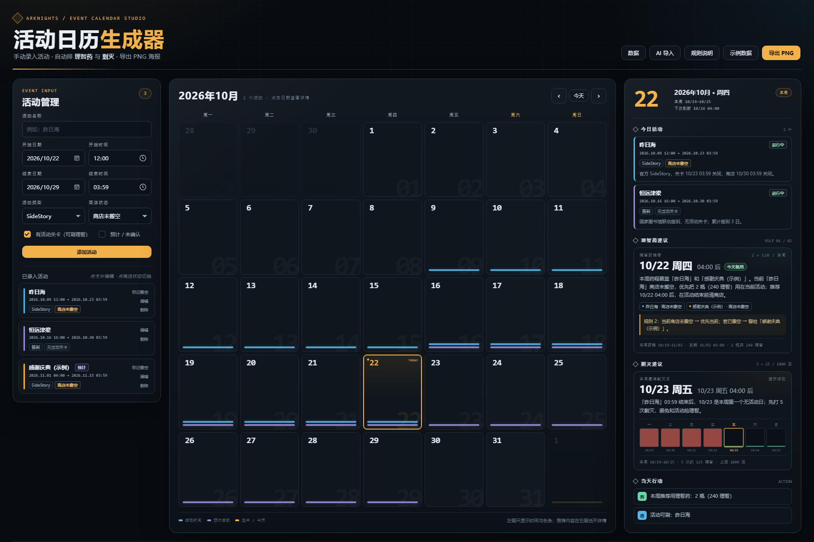
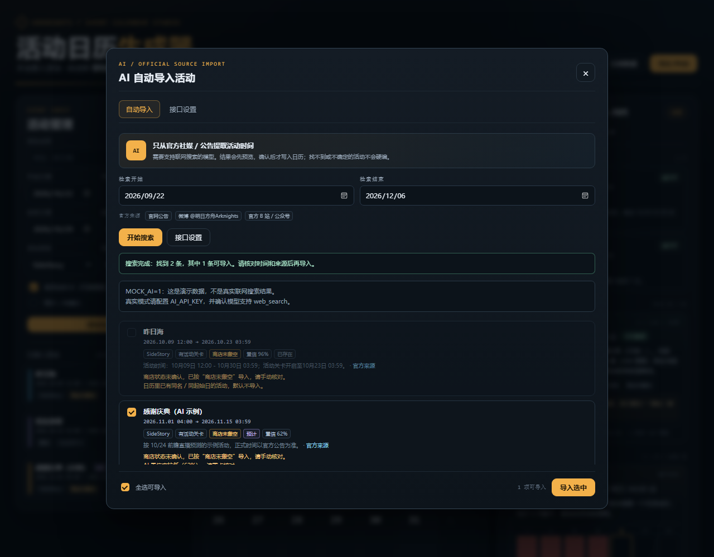
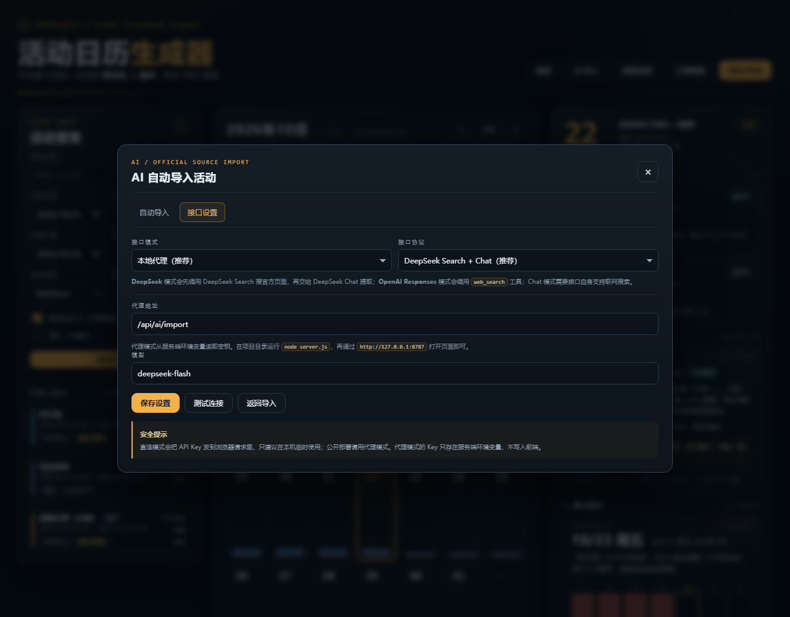
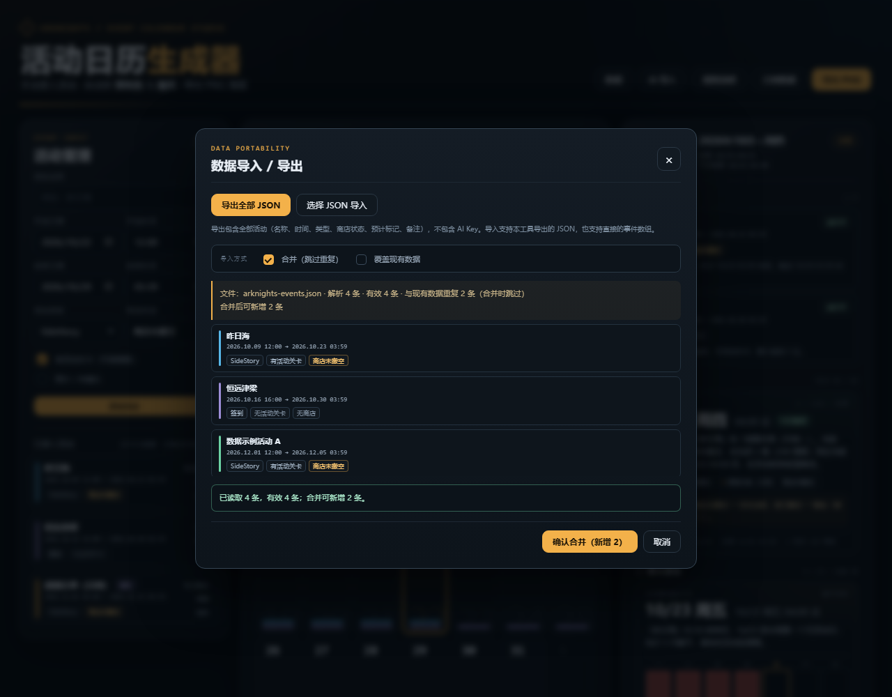

# 明日方舟 · 活动日历生成器

参考活动日历海报的深色工业风 UI，做一个可手动录入活动、自动排理智药和剿灭日期的本地网页工具。基础功能无需后端，直接用浏览器打开 `index.html` 即可；可选的 **AI 自动导入** 功能支持通过本地代理调用联网搜索模型，从官方社媒 / 公告提取活动时间。

## 快速开始

1. 双击打开 `index.html`（推荐 Edge / Chrome）。
2. 在左侧「活动管理」填写活动名称、开始日期/时间、结束日期/时间。
3. 选择活动类型、商店状态，勾选是否有活动关卡。
4. 点「添加活动」，左侧日历只显示日期和活动色条；点任意日期，右侧显示当天详情和推荐。
5. 点右上角「导出 PNG」，把当前月份 + 选中日期的排班导出成 2400×1600 海报。
6. 可选：点右上角「AI 导入」，配置接口后从官方社媒 / 公告自动提取活动；详见下文。

数据会保存在浏览器 `localStorage` 中，刷新页面不会丢；换浏览器或清缓存会丢。点「示例数据」可以恢复内置示例。

## 界面预览



AI 自动导入预览（演示模式）：



DeepSeek 接口设置：



手动数据导入预览：



## 核心功能

- **手动录入活动时间**：精确到分钟，支持 SideStory、复刻、签到、其他类型。
- **商店状态**：每个活动可标记「未搬空 / 已搬空 / 无商店」，直接参与理智药推荐。
- **活动关卡开关**：签到 / 登录类活动可关闭「有活动关卡」，不会被当成理智药目标。
- **预计活动**：勾选后日历色条显示为虚线，详情中标注「预计」，方便区分官方已确认和预测内容。
- **左侧日历只显示时间**：日期数字 + 活动色条 + 今天/选中状态，不显示活动名，避免日历过挤。
- **右侧当天详情**：今日活动、理智药推荐、剿灭推荐、当天行动。
- **一键导出**：Canvas 绘制 2400×1600 PNG，风格与页面一致。
- **数据导入 / 导出**：把全部活动导出为 JSON 备份，或从 JSON 合并 / 覆盖导入。
- **AI 自动导入（可选）**：默认适配 DeepSeek Search + DeepSeek Chat，从官网 / 官方微博 / 官方 B 站提取活动，先预览再导入。

## AI 自动导入

入口：右上角 **「AI 导入」** → 选择日期范围 → **开始搜索**。搜索结果会先列出：

- 活动名、开始 / 结束时间
- 类型、是否有活动关卡、商店状态
- 官方来源链接、公告原文摘录、置信度
- 与现有日历重复的条目会标记「已存在」并默认不导入
- AI 没给出商店状态的活动会按「商店未搬空」导入，并给出黄色警告，需人工核对

确认后点「导入选中」，活动才会写入日历；不会直接覆盖现有数据。

### 方式 A：DeepSeek 本地代理（推荐）

默认协议是 **DeepSeek Search + Chat**：先调 DeepSeek Search 搜官方页面，再把搜索结果交给 DeepSeek Chat 提取 JSON。

```powershell
# Windows PowerShell
$env:DEEPSEEK_API_KEY="sk-..."
$env:DEEPSEEK_MODEL="deepseek-flash"
node server.js
```

然后打开 <http://127.0.0.1:8787>，在「AI 导入 → 接口设置」确认：

- 接口模式：**本地代理（推荐）**
- 代理地址：`/api/ai/import`
- 接口协议：**DeepSeek Search + Chat（推荐）**
- 模型：`deepseek-flash`（或 `deepseek-v4-pro`）

也可以直接双击 `start-server.bat`（需要 Node.js 在 PATH 中）。

DeepSeek 官方接口：

- Chat Completions：`https://api.deepseek.com/chat/completions`
- Search：`https://api.deepseek.com/v1/tools/search`
- 模型：`deepseek-flash` / `deepseek-v4-pro`

> Search API 按成功请求计费，具体价格和限流以 [DeepSeek 官方文档](https://api-docs.deepseek.com/guides/search) 为准。

### 方式 B：浏览器直连

不想启动服务端时，在「接口设置」选择 **浏览器直连**，填：

- API Base URL：DeepSeek 填 `https://api.deepseek.com`
- API Key：`sk-...`
- 协议：DeepSeek Search + Chat
- 模型：`deepseek-flash`

直连会先调用 DeepSeek Search，再调用 DeepSeek Chat；但会受浏览器 CORS 限制，且 Key 会出现在浏览器请求里，只建议本机临时使用。公开部署请用代理模式。

也支持 OpenAI 兼容接口：

- 协议：OpenAI Responses + web_search，或 Chat Completions
- Base URL：如 `https://api.openai.com/v1`
- 模型：需要支持联网搜索

### 演示模式（不调用真实 AI）

```powershell
$env:MOCK_AI="1"
node server.js
```

或双击 `start-mock.bat`。代理会返回两条演示数据，用于检查弹窗、预览、去重和导入流程；**不是真实搜索结果**。

### 服务端环境变量

| 变量 | 说明 | 默认 |
|---|---|---|
| `DEEPSEEK_API_KEY` | DeepSeek Key，DeepSeek 模式优先使用 | 回退到 `AI_API_KEY` |
| `DEEPSEEK_API_BASE` | DeepSeek API 根地址 | `https://api.deepseek.com` |
| `DEEPSEEK_MODEL` | DeepSeek 模型 | `deepseek-flash` |
| `AI_API_KEY` / `OPENAI_API_KEY` | OpenAI 兼容接口 Key | 未配置时真实模式报错 |
| `AI_API_BASE` / `OPENAI_BASE_URL` | OpenAI 兼容接口根地址 | `https://api.openai.com/v1` |
| `AI_MODEL` | OpenAI 兼容模型名 | `gpt-4.1` |
| `AI_PROTOCOL` | `deepseek` / `responses` / `chat` | `deepseek` |
| `PORT` | 本地端口 | `8787` |
| `MOCK_AI` | 设为 `1` 返回演示数据 | 关闭 |

### 防止 AI 编造

- Prompt 明确限定只允许官网、官方微博、官方 B 站 / 公众号，禁止 NGA、TapTap、玩家 Wiki、攻略站。
- 要求返回 `sourceUrl` 和公告原文 `evidence`；没有来源会显示警告。
- 要求结束时间按公告原文写 `03:59`，不得自行改成 `23:59`。
- 没有明确结束时间的活动不猜；找不到就返回空数组。
- 结果必须人工确认后才会写入；重复项默认不导入。
- 商店状态无法确认时标 `unknown`，按未搬空导入并提示核对。

## 手动数据导入 / 导出

入口：右上角 **「数据」**。

- **导出全部 JSON**：下载所有活动，包含名称、起止时间、类型、商店状态、预计标记、颜色、备注；不包含 API Key。
- **选择 JSON 导入**：支持本工具导出的 `{ events: [...] }`，也支持直接的事件数组。
- **合并（跳过重复）**：按“活动名 + 开始日期”去重，保留现有数据。
- **覆盖现有数据**：先确认，再用文件中的活动整体替换。
- 解析时会跳过缺少 `name` / `start` / `end` 或结束早于开始的无效条目，并在预览中显示数量。

导出文件示例：

```json
{
  "app": "arknights-calendar-studio",
  "version": 1,
  "exportedAt": "2026-10-22T10:30:00.000Z",
  "events": [
    {
      "name": "昨日海",
      "start": "2026-10-09T12:00",
      "end": "2026-10-23T03:59",
      "type": "SideStory",
      "hasStages": true,
      "shopStatus": "uncleared",
      "forecast": false,
      "color": "#58b7e8",
      "note": ""
    }
  ]
}
```

## 推荐算法

### 1. 理智药推荐

按「每周 2 瓶 × 120 理智」建模：

- 以周一 04:00 为周起点。
- 本周获得的周常浓缩液，有效期按「领取后第二个周一 04:00」折算为 **本周周一 04:00 起 14 天**。
- 只考虑勾选了「有活动关卡」的活动；签到 / 登录活动不消耗理智，不参与。
- 在药程窗口内按开始时间排序：
  - 当前活动商店**未搬空** → 优先当前活动，推荐日期取活动结束前最后一个可用日。
  - 当前活动商店**已搬空**（或没有商店）→ 自动留给下一个有活动关卡的活动。
- 如果窗口内同时覆盖两个活动，详情会显示「规则 2」提示：
  - 当前未搬空：优先当前；若已搬空，则留给下一个。
  - 当前已搬空：已自动改为留给下一个。

> 药程窗口内没有可刷活动时，不硬塞日期，提示「留到下一个活动，临近到期再用资源收集」。

### 2. 剿灭推荐

- 每周 5 次 × 25 理智 ≈ 125 理智，1800 合成玉上限。
- 按「当天 04:00–次日 04:00」计算每个活动关卡对当天的覆盖小时数。
- 优先选**完全没有活动覆盖**的日期；多个空档时取最早的一天。
- 如果整周每天都被活动覆盖（≥23 小时/天），视为「活动全覆盖」，任意一天都可刷，默认推荐周一 04:00 刷新后。
- 没有完全空档、但也不是全覆盖时，选活动覆盖最少的一天，并提示在活动开始前/结束后打。
- 活动结束时间为 03:59 时，当天 04:00 后视为无活动，因此可以被选为剿灭日。

## 使用建议

- 录入活动时，结束时间按官方公告填 `03:59`，不要填 `23:59`；算法会按 04:00 日界线判断。
- 活动商店搬空后，记得在左侧活动卡片上点「标记搬空」，理智药推荐会立即改到下一个活动。
- 如果某个活动只是签到 / 登录，取消「有活动关卡」；否则它会被误认为可以刷理智。
- 预测活动请勾选「预计 / 未确认」，导出图会用紫色虚线标识。
- 日历色条只表示活动覆盖时间，不表示推荐；推荐看右侧。

## 文件结构

```
arknights-calendar-studio/
├─ index.html          # 页面结构
├─ styles.css          # 深色工业风 UI
├─ app.js              # DOM 渲染、表单、交互、Canvas 导出
├─ ai.js               # AI 导入弹窗、接口设置、结果解析与去重
├─ data.js             # 活动 JSON 手动导出 / 导入
├─ calendar-core.js    # 纯排班算法（浏览器 / Node 共用）
├─ server.js           # 可选：静态服务器 + AI 代理（密钥留在服务端）
├─ start-server.bat    # Windows 一键启动代理
├─ start-mock.bat      # Windows 一键启动 AI 演示模式
├─ preview.png         # 界面预览
├─ preview-ai.png      # AI 自动导入预览
├─ preview-ai-settings.png # DeepSeek 接口设置预览
├─ preview-data.png    # 数据导入预览
├─ README.md
└─ tests/
   └─ core.test.js     # Node 算法测试
```

## 运行测试

需要 Node.js：

```bash
node tests/core.test.js
```

测试覆盖：

- 周一 04:00 周起点边界
- 理智药「当前未搬空 → 当前」「当前已搬空 → 下一个」
- 活动结束 03:59 后，次日成为剿灭空档
- 活动全覆盖时，剿灭任意日 / 默认周一
- 动态月历行数（10 月 5 行、11 月 6 行）

## 说明

这是玩家侧的排班辅助工具，不代表官方规则。活动时间、商店关闭时间、理智药到期时间、剿灭上限等最终以游戏内显示和官方公告为准。
